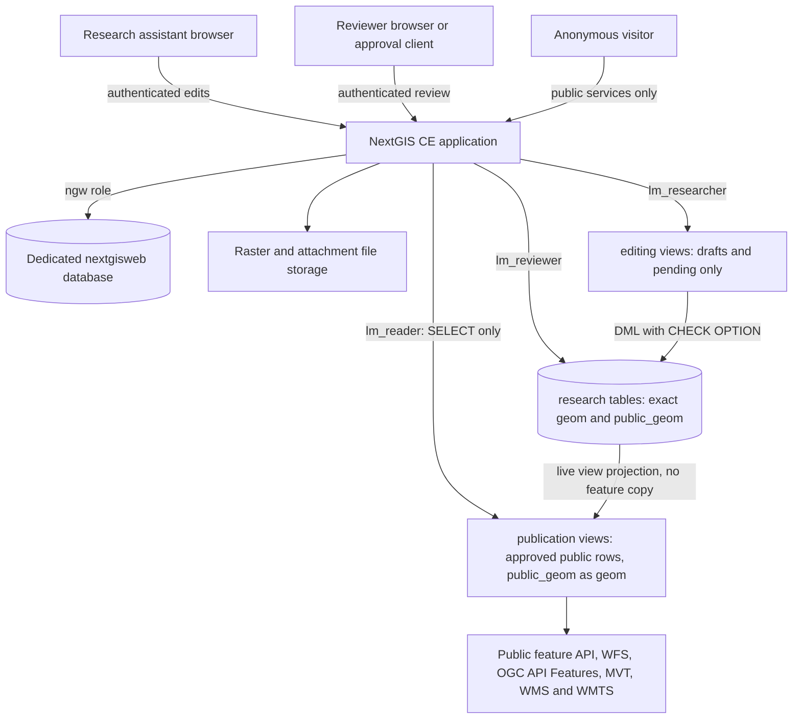

# NextGIS Web: modern PostgreSQL and secure publishing follow-up

**NC State Listening Machine — evaluated 12 October 2026, America/New_York (13 October UTC). Synthetic data only.**

## Executive summary

**Retain the existing GeoServer deployment for now. NextGIS is a credible editing/publication pilot, but this test does not justify a production migration.** Both previously identified technical obstacles have workable solutions:

- **Modern database:** the unchanged official NextGIS CE image ran successfully against a separate PostgreSQL **17.5 / PostGIS 3.5.2** server. A small custom launcher bypassed the bundled database supervisor. Application initialization, migration checks, native vector editing, raster rendering, MVT, restart persistence, and a fresh restore worked. No application fork or custom image build was necessary.
- **Secure publication without feature copies:** three external PostGIS tables, restricted editing views, and read-only publication views supported point, line, and polygon editing in the actual browser. Anonymous feature APIs, WFS, OGC API Features, MVT, WMS, and WMTS used only approved rows and publication-safe geometries. Database connections using the public role could not read the research tables. Removing HTTP filters did not bypass SQL view restrictions.

These successes have important limits. The launcher is a **custom integration of an official artifact**, not an officially documented CE external-database deployment. PostgreSQL 17 is supported, but the downloaded PostGIS image contained **17.5, substantially behind the current minor release**; the tested image is not an acceptable production patch baseline. Enabled raster tile caching retained a withdrawn feature until flushed. External PostGIS layers did not offer NextGIS's native version-history UI. Review actions worked through the API, but a polished approval interface and operational safeguards remain project work.

The live-view architecture is materially better than the previous copy-to-public demonstration. It does **not** establish that replacing NC State's existing GeoServer would reduce total maintenance: the comparison architecture and university integrations were not deployed in this evaluation.

## Scope, evidence, and environment

**PASS** means the stated behavior was observed. **FAIL** means a tested acceptance condition was not met. **NOT TESTED** means no runtime verification was completed. Documentation/source findings and architectural inference are explicitly identified below; they are not runtime passes.

Read-only project context was the existing `nextgis-evaluation.md`. No research files were opened, no existing GeoServer endpoint was contacted, and no existing deployment was changed. The only project file written is this requested report. Existing Python and Playwright installations were reused without modification. Browser requests to hosts other than `127.0.0.1` were blocked by the harness.

| Item | Exact observation |
|---|---|
| Host | Ubuntu WSL2, Linux `5.15.153.1-microsoft-standard-WSL2`, amd64; Docker client/engine 27.3.1 |
| Isolated directory / resource prefix | `/tmp/lm-nextgis-followup-oQhCjxDT` / `lm-nextgis-followup-oQhCjxDT-` |
| Primary / fresh-restore HTTP bindings | `127.0.0.1:18088:8080` / `127.0.0.1:18089:8080` |
| Database exposure | Separate Docker networks; database port **not published** to the host |
| Application image | `nextgis/nextgisweb-ce:26.07.0` |
| Application repository digest | `sha256:2cf70ea28e5c9da8be36b36461776fabf7f1e7f360e15f7a7e3fdd593a7e5afa` |
| Application image ID | `sha256:414ff541c2c33702a085c1e91d0e577ed9b73898b590bd0789bb5e40a8730075` |
| Application image size / creation | 3,987,109,390 bytes / `2026-07-27T04:27:34.548539847+03:00` |
| Database image | `postgis/postgis:17-3.5` (PostGIS project's published image) |
| Database repository digest | `sha256:01a6a70e41e6c4467c8f55f6063555ed72db2d6662cd0d571040d42eadaeb6f6` |
| Database image ID | `sha256:2ed748fc602dd3031c6724db8cb289e1578c2deb552a4f6e291f6f7e5e6e4f69` |
| Database image size / creation | 636,764,083 bytes / `2026-08-31T11:34:38.705037667Z` |
| Running application packages | `nextgisweb=5.5.0`, `nextgisweb_mapserver=3.1.0`, `nextgisweb_qgis=3.9.0` |
| Running database and extensions | PostgreSQL 17.5, PostGIS 3.5.2; database-side GEOS 3.9.0 and PROJ 7.2.1 |
| Application runtime | Ubuntu 24.04.4, Python 3.12.3, uWSGI 2.0.31; GDAL 3.8.4; bundled MapServer build 8.4.0 |
| Database utilities in application | `/usr/bin/pg_dump` and `/usr/bin/pg_restore`: 18.4; successfully backed up/restored PostgreSQL 17 |
| Evidence volume | 312 recorded scripted HTTP requests, plus Chromium network events, SQL connections, process inspection, and logs; representative sanitized evidence embedded below |

## Phase 1: deployment investigation

The Docker Hub tag listing returned `latest` and `26.07.0`, updated 27 July 2026; no newer CE tag appeared in the inspected listing. The CE GitHub releases API returned an empty release list. The inspected repository master tree was `ea8b29df03973f0100854a7699ebc758ca64885b`.

**Source findings:** `crater.yaml` specifies `single_container: true`, Ubuntu 24.04, and PostgreSQL `12`. The vendored Dockerfile explicitly installs PostgreSQL 12 server packages. Its default entrypoint selects database binaries and, for server commands, launches s6 services including PostgreSQL and uWSGI. Merely overriding the database connection does not remove that startup path. The repository says its private `crater` generator is not needed to build because generated build files are vendored. Rebuilding CE with a newer bundled PostgreSQL would still make NC State responsible for that distribution variant. [CE repository](https://github.com/nextgis/nextgisweb_ce), [build configuration](https://github.com/nextgis/nextgisweb_ce/blob/ea8b29df03973f0100854a7699ebc758ca64885b/crater.yaml), [vendored Dockerfile](https://github.com/nextgis/nextgisweb_ce/blob/ea8b29df03973f0100854a7699ebc758ca64885b/build/Dockerfile)

**Documentation findings:** source installation documents a separately configured PostgreSQL/PostGIS database and uWSGI deployment, with minimum PostgreSQL 12 and PostGIS 3 requirements. It requires an application database with ownership of specified spatial metadata objects and warns about its SRS management. It does not constitute explicit PostgreSQL 17/18 certification. No official CE Compose example specifically using PostgreSQL 17/18 was established by this investigation. [Source installation](https://docs.nextgis.com/docs_ngweb_dev/doc/admin/install.html), [upgrade instructions](https://docs.nextgis.com/docs_ngweb_dev/doc/admin/upgrade.html)

**Selected approach:** retain the official application image, override its entrypoint, invoke its shipped `server-uwsgi` script, and supply an external database configuration. This is a small, realistically maintainable integration, but depends on internal image paths and startup hooks. It must be regression-tested on image upgrades. An independently maintained source build was unnecessary and was not attempted.

**Runtime architectural verification:** both deployed application containers had only uWSGI processes; neither ran PostgreSQL or s6. The image's pre-existing `data/postgres` directory contained no database files. `pg_stat_activity` on the external server showed application connections as `ngw` to `nextgisweb` and `lm_researcher`, `lm_reviewer`, and `lm_reader` to `research`. The application image still contains unused PostgreSQL 12 binaries; bypassing their process does not update or remove the packages.

**Patch warning:** PostgreSQL's policy page listed 17.11 as the current 17.x minor, with major-version support through 8 November 2029. The pulled `17-3.5` image actually ran **17.5** despite its recent image creation timestamp. This test proves compatibility with a supported major, **not compatibility testing on the current patched minor or a fully current production stack**. NC State should use an institutionally patched PostgreSQL/PostGIS service and re-run these checks. PostgreSQL 12 remains end-of-life. [PostgreSQL version policy](https://www.postgresql.org/support/versioning/)

Reusing NC State's PostgreSQL service is architecturally feasible: allocate a **dedicated `nextgisweb` database**, application role, required extensions/object ownership, and a separately governed research database/schema. Do not point NextGIS metadata initialization at an existing shared application database. Actual NC State extension availability, privileges, TLS, networking, quotas, and backup policy are **NOT TESTED**. PostgreSQL 18 was investigated as an option but not deployed. The PostGIS repository lists modern major-version variants; a registry request for `17-3.6` returned 404 during this run, so it was not silently substituted. [PostGIS Docker project](https://github.com/postgis/docker-postgis)

## Results matrix

### Deployment, data, and recovery

| Test / acceptance condition | Result | Evidence / qualification |
|---|---|---|
| Docker availability, official image pull, application startup, web/API access | **PASS** | Image digests recorded; `/login` and package-version API returned 200; researcher browser login succeeded. |
| Newer official CE image with modern bundled PostgreSQL | **NOT TESTED** | No newer candidate found in inspected registry/repository. Existing CE source still selects 12; no nonexistent image was assumed. |
| Separate supported-major PostgreSQL deployment | **PASS** | PostgreSQL 17.5/PostGIS 3.5.2 queried from running database; application used it successfully. |
| Current PostgreSQL minor/security patch baseline | **FAIL** | Tested database was 17.5; current-minor policy listed 17.11. No patch-upgrade rehearsal performed. |
| Bundled database actually disabled | **PASS** | Process lists contained uWSGI only; no bundled cluster files; external `pg_stat_activity` confirmed connections. Requires entrypoint override. |
| PostGIS enablement and application initialization | **PASS** | `CREATE EXTENSION postgis`, `postgis_raster`; startup initialized NextGIS successfully. |
| Migration machinery | **PASS** | Restart logged `Database migration ...`; `nextgisweb migration status` marked installed migrations applied. Same-version initialization/restart only. |
| Upgrade from another NextGIS release or PostgreSQL major | **NOT TESTED** | Neither an old database migration nor an application version upgrade was attempted. |
| Native vector creation and geometry/attribute editing | **PASS** | Native resource 21, feature 1 reached version 3, `POINT(-78.64 35.79)`, name `Native edited`. |
| Synthetic raster upload and XYZ rendering | **PASS** | 256×256 RGB GeoTIFF imported; raster style 23 returned 200 PNG, 740 bytes, at z10/x288/y402. |
| Native and external MVT delivery | **PASS** | Native point tile 200/55 bytes; external point/line/polygon tiles decoded with GDAL, containing publication-safe coordinates and fields. |
| Restart persistence | **PASS** | Stopped app, restarted database, restarted app; nine response hashes matched exactly, including geometry collections, raster PNG, attachment. |
| Clean application shutdown | **FAIL** | Stop emitted `corrupted double-linked list` and `corrupted size vs. prev_size`. Restart and data verification succeeded; root cause not diagnosed. |
| Backup creation and integrity | **PASS** | NextGIS archive: 244,889 bytes, 80 ZIP members, CRC check passed. Separate research database dump: 33,491 bytes. |
| Restore into fresh independent instance | **PASS** | New network, database/data/backup volumes and app/database containers; restored application and research backups; same nine response hashes matched. |
| NextGIS backup alone recovers external research data | **FAIL** | Before research dump restore, native data/raster worked but public external-layer request returned 503. After research restore it worked. Expected operational boundary. |
| Current-minor deployment, PostgreSQL 18, source build, NC State database integration | **NOT TESTED** | No claim of tested support for these variants. |

### Live publication and authorization

| Test / acceptance condition | Result | Evidence / enforcement |
|---|---|---|
| Three typed synthetic research tables and safe-geometry views | **PASS** | Point, LineString, Polygon tables; SQL catalog confirmed ordinary views with `security_barrier=true`. |
| Actual public-role database privilege checks | **PASS** | TCP login as `lm_reader`: public view SELECT succeeded; research/editing SELECT, view UPDATE, and `SET ROLE lm_owner` denied. |
| Publish views through feature API, WFS, OGC API Features, MVT | **PASS** | All three shapes served; WFS GetFeature tested at 1.0.0, 1.1.0, 2.0.0; OGC collections/items returned 200. |
| Researchers edit underlying private data and submit for review | **PASS** | External editing-view POST/PUT and `review_status=pending` succeeded for all shapes, without copies. |
| Reviewer supplies safe geometry and approves | **PASS** | Reviewer modified safe-geometry layer and approval fields; public feature appeared immediately. API demonstration; reviewer browser approval operation **NOT TESTED**, dedicated review UI not implemented. |
| Approved records inaccessible through researcher editing view | **PASS** | Feature 6 returned 404 after approval in each geometry's editing layer. Approved data could not be edited through that view. |
| Withdrawal without dataset recreation | **PASS** | Reviewer set point 1 private; feature API/OGC item returned 404, count/extent changed; MVT omitted it and WMS area became transparent. |
| Live publication without duplicate/synchronized feature datasets | **PASS** | Editing and public views reference the same three source tables. Views have no feature storage; NextGIS native vector layer was a separate regression fixture only. |
| Anonymous private features, geometries, exports, attachments | **PASS** | Feature list/item/count/extent/export and attachment list/download/export/bundle probes denied with 403; an actual synthetic attachment was present. |
| Anonymous private GeoTIFF and raster tile | **PASS** | Raster download and style tile requests returned 403; authenticated controls returned data. |
| Removing feature filters cannot bypass restrictions | **PASS** | Unfiltered and changed-filter requests stayed within publication views; secret/draft/null-safe-geometry fixtures remained absent. SQL boundary, not browser filter. |
| Direct feature IDs cannot expose restricted rows | **PASS** | Public feature IDs 2–5 returned 404; OGC item ID 2 returned 404; WFS restricted-ID probe disclosed no restricted record. |
| MVT contains only publication-safe geometry/attributes | **PASS** | Decoded safe tiles; exact-private-location tiles returned 204; private-layer MVT returned 403. |
| WMS/WMTS cannot render exact private geometries | **PASS** | Safe extent/tile images had nontransparent pixels; exact private extent/tile images were transparent for all three shapes. |
| Public listings/schema/count/extent omit private metadata | **PASS** | Public-only WFS/OGC/WMS/WMTS configurations; capabilities, schemas, collections and counts/extents contained public data only in tested responses. |
| Public services reference no private resources | **PASS** | Service/map JSON showed only public layer IDs 12/16/20 and their styles 27/28/29. |
| Four identities and authentication | **PASS** | Anonymous, researcher, reviewer, administrator exercised; wrong researcher password 401; valid login 200. |
| Researcher cannot self-approve or replace safe geometry | **PASS** | PostgreSQL check option rejected approval; underlying table access denied; reviewer/safe/public layer writes denied by NextGIS ACLs. |
| Nonadministrators cannot change publication configuration/users | **PASS** | Resource modification and user-management API probes returned 403 for researcher and reviewer. |
| Withdrawal automatically invalidates an enabled raster cache | **FAIL** | Identical previously cached PNG still served after SQL-backed feature disappearance. |
| Withdrawal after explicit cache flush | **PASS** | `tile_cache.flush=true` made the same XYZ request return 204; final public point style cache disabled. |
| CDN/browser/offline cache revocation and concurrent review races | **NOT TESTED** | No CDN configured; no concurrency/fault injection tests. Downloaded public data cannot be recalled. |
| Strict public-process isolation from private credentials | **NOT TESTED** | One trusted app handled all three DB connections; database-role separation is not application-process isolation. |

### Browser and usability

| Test / acceptance condition | Result | Evidence |
|---|---|---|
| Create points in configured Web Map as researcher | **PASS** | Chromium Create → map click → attributes → Stop editing → Save; underlying feature 7 created. |
| Draw lines and polygons in configured Web Map | **PASS** | Vertex clicks/double-click completion; attributes and save produced feature 7 in each table. |
| Modify point, line and polygon geometries | **PASS** | Feature-table Geometry tab, Modify drag, Save; real PUT 200 for resources 9/13/17. SQL audit confirmed changed geometry for all three. |
| Edit attributes and view persisted changes | **PASS** | Browser changed descriptions to `Browser reshaped points/lines/polygons`; table and SQL readback matched. |
| API deletion through editing views | **PASS** | Temporary feature 8 created/deleted in each shape; DELETE 200 then GET 404. Browser deletion was **NOT TESTED** in this follow-up. |
| Native NextGIS version-history UI | **PASS** | Resource 21 showed Version history and researcher activity in Chromium. |
| Native version-history UI for external PostGIS views | **FAIL** | External resource 9 had no Version history link or versioning section; ordinary external features lacked native version IDs. |
| Production-grade per-person audit for external data | **NOT TESTED** | Small SQL audit trigger demonstrated changes, but records shared DB role, not individual NextGIS username; no audit UI developed. |
| Usability study with actual research assistants | **NOT TESTED** | Automation establishes operability, not learnability, accessibility, or user satisfaction. |

Architecture comparison is an analysis, not an additional runtime pass. Load, HA/failover, SSO/MFA, TLS integration, vulnerability scanning, and long-term upgrade maintenance were **NOT TESTED**.

## Selected architecture and secure publication design

Two runtime services: **NextGIS/uWSGI** and **PostgreSQL/PostGIS**. PostgreSQL contained a dedicated NextGIS application database and a separate research database. Three role-specific PostGIS connections were configured in NextGIS.



The arrows through views represent database access; all HTTP requests still pass NextGIS authorization. Public services were configured exclusively against publication resources. This avoids the earlier mixed-service metadata problem by removing private references; it does **not** fix the upstream behavior of arbitrary mixed public/private services.

### Database structure and enforcement

Each geometry type used its own typed table with `id`, `name`, `description`, `visibility`, `review_status`, `geom`, `public_geom`; both geometry columns had GiST indexes. The public SQL projection exposed only `id`, `name`, `description`, and **`public_geom AS geom`**. No private geometry column was exposed to the public connection.

The editing view exposed `id`, `name`, `description`, `review_status`, and exact `geom`, only where status was draft/pending, with **`WITH CASCADED CHECK OPTION`**. Researchers had DML on this view, not on base tables. They could submit pending records but could not set approved status, set visibility, change safe geometry, or modify already approved rows. The reviewer connection accessed the base table. Separate reviewer layers selected either `geom` or `public_geom` as their geometry column.

The views were owned by a separate NOLOGIN owner role, not by the public account. PostgreSQL's default view-owner permission behavior allowed the public role to read the approved projection while denying access to the underlying table. `security_barrier` helps preserve the intended ordering of potentially leaky user predicates; it is **not a substitute for privileges or the editing check option**. No PostgreSQL row-level-security policy was required for this specific design. [PostgreSQL CREATE VIEW](https://www.postgresql.org/docs/17/sql-createview.html)

The public and editing PostGIS resources used explicit geometry type/SRID, integer ID column, and `fields: "update"` to discover columns. Views required no synthetic NextGIS feature table or import job. Their spatial indexes are the **base table's indexes**; large-data query plans/performance were not benchmarked. External tables/views and native NextGIS vectors have different storage/versioning behavior. NextGIS documents external PostGIS table/view layers; runtime testing here established write support for these particular automatically updatable editing views. [NextGIS PostGIS layers](https://docs.nextgis.com/docs_ngweb/source/postgis_details.html)

### Sanitized SQL evidence from separate authenticated TCP connections

```text
lm_reader: SELECT id,name,ST_AsText(geom) FROM publication.points;
exit 0: 1|Published points|POINT(-79.2 36.2)

lm_reader: SELECT * FROM research.points;
exit 3: ERROR: permission denied for schema research
lm_reader: SELECT * FROM editing.points;
exit 3: ERROR: permission denied for schema editing
lm_reader: UPDATE publication.points SET name='hacked' WHERE id=1;
exit 3: ERROR: permission denied for view points
lm_reader: SET ROLE lm_owner;
exit 3: ERROR: permission denied to set role "lm_owner"

has_table_privilege(lm_reader, research.points OID, SELECT) -> f
has_table_privilege(lm_reader, publication.points, SELECT) -> t

lm_researcher: UPDATE editing.points SET review_status='approved' WHERE id=5;
exit 3: ERROR: new row violates check option for view "points"
lm_researcher: UPDATE editing.points SET visibility='public' WHERE id=5;
exit 3: ERROR: column "visibility" of relation "points" does not exist
lm_researcher: UPDATE research.points SET public_geom=geom WHERE id=1;
exit 3: ERROR: permission denied for schema research

lm_researcher: UPDATE editing.points SET review_status='pending' ... RETURNING ...;
exit 0: 5|pending (test transaction rolled back)
lm_reviewer: UPDATE research.points SET review_status='approved',
             visibility='public',public_geom=ST_GeomFromText('POINT(-79.3 36.3)',4326) ...;
exit 0: UPDATE 1 (test transaction rolled back)
```

These were actual password-authenticated `psql -h 127.0.0.1 -U lm_...` connections inside the test database container, not just superuser `SET ROLE` simulations. PostgreSQL catalog object names are not a secrecy boundary for someone given database credentials; those credentials must never be handed to anonymous users.

### HTTP and publication evidence

Synthetic fixtures included public-approved, private-approved, public-draft, approved-with-null-safe-geometry, and private-draft rows. Initial exact point `(-78.65,35.78)` differed substantially from safe point `(-79.2,36.2)`; lines/polygons had corresponding distinct extents.

```text
POST /api/resource/9/feature/?srs=4326          researcher -> 200 {"id":6}
PUT  /api/resource/9/feature/6                  researcher -> 200 (geometry/attributes/pending)
PUT  /api/resource/9/feature/6                  researcher -> 503 (attempt approved)
     PostgreSQL CHECK OPTION rejected it; public GET remained 404.
PUT  /api/resource/11/feature/6?srs=4326        reviewer   -> 200 (safe geometry)
PUT  /api/resource/10/feature/6                 reviewer   -> 200 (public + approved)
GET  /api/resource/12/feature/6?srs=4326         anonymous  -> 200
     {"id":6,"geom":"POINT(-79.3 36.3)",
      "fields":{"name":"Submitted points","description":"Edited then submitted"}, ...}
GET  /api/resource/9/feature/6                  researcher -> 404 (now outside editing view)
PUT  /api/resource/12/feature/6                 researcher -> 403
GET  /api/resource/12/feature/2                 anonymous  -> 404
GET  /api/resource/10/feature/                  anonymous  -> 403
GET  /api/resource/9/feature/5/attachment/1/download
                                               anonymous  -> 403; researcher -> 200, 32 bytes
```

Equivalent submission/approval tests ran for lines and polygons. Requests trying unknown `visibility`/`public_geom` fields on the editing layer returned 200 but ignored those fields; they did not confer publication rights. Invalid approval was surfaced as a generic **503 External database error**, an awkward user experience even though the database correctly denied it.

GDAL-decoded MVT examples (quantization accounts for small coordinate differences):

```text
points:   mvt_id=1, name="Published points", geom≈[-79.2000103,36.2000273]
points:   mvt_id=6, name="Submitted points", geom≈[-79.3000031,36.2999776]
lines:    mvt_id=1, endpoints≈[-79.2499638,36.1500042]..[-79.1499710,36.2500185]
polygons: mvt_id=1, bounds≈[-79.2499638,36.1500042]..[-79.1499710,36.2500185]
```

Only approved public names/descriptions were present. Exact-location tile z10/x288/y402 was empty for these public external layers. Safe tile z10/x286/y401 contained safe features. Public WMS/WMTS images were decoded and their alpha channels checked; checking HTTP 200 alone would not establish geometry privacy.

After withdrawal, public point metadata returned:

```json
{"total_count":1}
{"extent":{"minLon":-79.3,"maxLon":-79.3,"minLat":36.3,"maxLat":36.3}}
```

Public WFS and OGC service configurations referenced only IDs `12,16,20`; WMS/WMTS referenced their styles `27,28,29`. Capabilities/schema/collection responses were checked for private names, fields (`visibility`, `review_status`, `public_geom`), secret fixture markers, and exact private coordinates. This is targeted testing, not proof against every metadata or side-channel disclosure.

### Withdrawal and caching: observed failure and mitigation

With the other public point temporarily withdrawn, the point style cache was enabled and its safe-location PNG warmed three times. Then the reviewer withdrew the remaining point:

```text
GET public feature /12/feature/1                    -> 404
GET MVT ?resource=12&z=10&x=286&y=401                -> 204
GET raster tile ?resource=27&z=10&x=286&y=401&nd=204 -> 200, 753 bytes
cached PNG identical to pre-withdrawal PNG          -> true
PUT /api/resource/27 {"tile_cache":{"flush":true}} -> 200
GET same raster tile                               -> 204
```

The final style was left with caching disabled, then approved point 6 was republished. Its decoded MVT contained **only ID 6**, not withdrawn ID 1; a WMS request around ID 1's safe location was transparent. An initial harness assertion incorrectly expected an empty tile while another legitimate public point still occupied it; isolating the fixture resolved that assertion and produced the results above.

For production, either disable server-side public tile caching or make withdrawal an audited procedure that invalidates **all affected style/proxy/CDN caches**. A role permitted to edit review data was not given resource-configuration rights; tested cache flushing required administrator authority. A narrowly scoped publication endpoint could encapsulate this operation. Client-held/downloaded data remains outside server revocation control.

## Researcher workflow and custom development

A researcher can use a configured Web Map, choose a layer's **Edit** menu, draw features, enter attributes, and use **Stop editing → Save**. The feature table offers an explicit Geometry tab with Create/Modify/Move controls. Chromium exercised points, multi-vertex lines, and polygons under the nonadministrator researcher account. Subsequent PUT requests returned 200, and SQL audit rows recorded `geometry_changed=t` for all three shapes. Descriptions persisted as `Browser reshaped ...`.

The interface is plausible for a trained research assistant, but administrators must first configure database schemas/roles, PostGIS connections, layer fields, styles, permissions, and Web Maps. The draft/pending value was a text field, not a guided submission action. Generic database-error dialogs and the two-stage map save flow require explanation. Basemap traffic was blocked, so geometry editing was tested on a blank background; contextual map usability was not assessed. An initial coordinate-based automation attempt missed a feature after the map view changed; the feature-table geometry editor successfully completed the reshaping tests.

The tested minimal workflow needs **custom SQL configuration, but no custom feature synchronization or application extension**:

1. Researcher edits drafts/pending rows through restricted views.
2. Researcher changes status to pending.
3. Reviewer checks content and supplies a safe geometry through a separate safe-geometry layer, then approves/publicizes through the review layer/API.
4. Publication view updates immediately.
5. Reviewer withdraws by setting visibility private; cached derivatives must be handled.

Recommended project development is a small review interface/API that validates transitions, validates/sanitizes public text and geometries, records the actual person/action, and performs withdrawal invalidation. Protect it with separate reviewer authorization; hiding controls in JavaScript is insufficient.

**No duplicate public feature dataset is required for the demonstrated workflow.** It does have a revision limitation: approved rows are locked out of the researcher view. To revise them, a reviewer must return/withdraw them into draft status. Keeping an old approved version public while privately editing a new revision requires a revision/snapshot model beyond this single-row design. Native NextGIS vectors were not joined to internal application tables; depending on those private storage internals was unnecessary.

**Version history is a tradeoff:** the native regression layer showed the built-in history page and researcher activity. External PostGIS layers did not. A small SQL trigger captured old/new rows and `session_user`, proving changes but attributing them to shared roles such as `lm_researcher`. It is not per-person history, an immutable audit system, or a replacement for the native history UI. Attachments/descriptions managed as NextGIS feature extensions are resource-specific and did not automatically publish through the SQL views. Public attachment publication would require an explicit, reviewed design.

## Storage, recovery, and operations

The original app database, external research database, and raster/attachment file storage are all required for recovery. The NextGIS backup restored application metadata, native features/versioning, raster files, and the synthetic attachment. It did not restore the external research tables, indexes, views, roles, or audit data. The research `pg_dump -Fc` restored those database objects after the login/owner roles were recreated. Real production credentials and configuration need protected recovery handling as well.

Fresh restore used a **new network and three new volumes**, not the original database or application data. The same hostname `db` resolved to the new database container inside the new network. Before the external restore, native features and raster tiles worked while the publication view request failed with 503. After restoring the research dump, all nine response hashes matched both the original state and the post-restart state. Selected hashes:

| Restored object / HTTP response | SHA-256 |
|---|---|
| Native feature collection | `593cd904b8a981df407f291bdd690353cfd225879c9e5ffa1c71d07ef670018e` |
| Public point collection | `665e3a43fd840f32bfecdeb634bac9b250e951bbbb9d26e3ed90570c16e52bcf` |
| Raster PNG | `2efeb2e60a79fb99df15468454ea6b758f0295aac76bb41f4120b3d69cb9d1bf` |
| Private attachment | `d36c0ca4861384330a2eb56d9415949371fba5684df622c02413cc4c88d6c69b` |

The nine checks covered native features, three editing-view collections, three public collections, raster PNG, and attachment. Restored anonymous/private authorization and researcher login were also rechecked. The test was quiescent during final backups; consistency across two databases and filesystem storage under active concurrent editing remains untested. Plan coordinated backup windows or a documented consistent snapshot procedure, encrypted off-host retention, role/secret recovery, and regular fresh restores.

No Redis or additional application service was needed for this test. GIS dependencies remain substantial inside the roughly 4 GB application image: Python/uWSGI, GDAL/PROJ/GEOS, MapServer, QGIS/Qt components, database clients, and unused bundled PostgreSQL binaries. Separating PostgreSQL makes its lifecycle independent; it does not remove application dependency maintenance. The shutdown allocator errors deserve investigation before production, despite successful restart/restore checks.

## Architecture comparison

This table combines observed A behavior from the previous report, observed B behavior here, and **architectural inference/documentation** for C. No existing NC State GeoServer service was changed or empirically re-evaluated.

| Concern | A. Stock NextGIS CE | B. NextGIS + separate modern PostgreSQL | C. Existing GeoServer + PostGIS + browser editor |
|---|---|---|---|
| Independently managed services | One container, with application and database processes coupled | Two services; one app and one DB service, two databases in this design; university DB could replace local DB container | Existing GeoServer and DB services, plus maintained editor frontend; approval/API may be another service or part of an existing app |
| Install/update | Official single-container procedure; simplest initial startup | Small custom launcher/config, image pinning, independent DB lifecycle; test launcher/hooks on upgrades | Preserve existing deployment; implement/integrate editing and review components |
| Database patches | Current inspected CE bundles EOL PG12 | Supported major works; tested PostGIS image's old minor must be replaced/updated | Uses existing institutionally managed DB lifecycle if available; its current patch state was not inspected |
| Backup/restore | Coupled app/database/files; external layers still need separate backups | Two DB recovery sets, application files, roles/secrets; fresh restore demonstrated | GeoServer configuration/data + PostGIS + editor/approval configuration; rehearsal not performed here |
| Researcher editing | Integrated editor; native layer history | Integrated editor works on restricted PostGIS views; native history absent for them | Browser editor must be selected/built; no usability claim from this test |
| Privacy/publishing | Native filters not security; mixed-service metadata risk | DB-restricted views, separate connection roles, public-only services, guarded workflow/cache handling | Same database publication-view principle can be reused; server/editor roles and caches require configuration and testing |
| Custom work | Secure approval workflow; likely external DB integration or synchronization | SQL schema/roles/views, launcher; review UX, per-person audit and optional cache invalidation | Editor integration plus approval/auth/audit; database/view design common to both |
| After-capstone burden | Small service count obscures coupled database lifecycle | Moderate; plausible if an owner accepts the deployment integration and PostgreSQL responsibilities | Likely less migration burden; amount of new editor code remains a material unknown |

GeoServer documents database-backed layers, read-only configured SQL Views, and catalog security modes. Do not equate its configured SQL Views with every ordinary PostgreSQL view or assume a write path works without testing. A C implementation could keep public publishing read-only while a separately authorized editor updates research data. [GeoServer SQL Views](https://docs.geoserver.org/main/en/user/data/database/sqlview/), [GeoServer layer security](https://docs.geoserver.org/main/en/user/security/layer/)

**Inference:** B saves substantial editor development compared with building an editor from scratch. C saves migration and introduces fewer changes to established infrastructure. Service counts alone do not resolve that tradeoff. A short pilot with real assistant usability testing and a named long-term operations owner is more informative than committing to replacement based on this demonstration.

## Security, sovereignty, and remaining production blockers

1. **Patch and support ownership:** move to current PostgreSQL/PostGIS patches, establish a supported external-DB NextGIS deployment route or formally own the launcher, and test upgrades. Unused old binaries remain in CE. No vulnerability certification was performed.
2. **App trust boundary:** public SQL uses a restricted account, but one NextGIS application stores/uses researcher and reviewer connections too. Application compromise, administrator access, or leaked backup/connection secrets can exceed public SQL privileges. Stronger isolation would require separate public/private application processes or another security architecture, increasing complexity.
3. **Permission configuration:** researcher/reviewer roles lacked resource administration. Public connection required resource-read/connection-connect but was **not** granted `connection.read`; returned public connection JSON omitted database username/password. Connection administration belongs only to trusted administrators.
4. **Publication quality:** database rules enforce status/visibility and safe-column selection, not whether a reviewer-approved geometry/text is actually safe. Free text, public names, and attachments need review. Approval and geometry changes should be controlled/atomic enough for the intended workflow; concurrency was not tested.
5. **Caches and history:** automate or avoid tile caches; provide per-person audit and a revision policy. A withdrawn feature already downloaded by a visitor cannot be recalled.
6. **Metadata:** keep all public service/map references public-only. Reintroducing a private reference can reintroduce the previous exposure. Layer names, schemas, counts and extents were tested on this configuration, not universally certified.
7. **University integration:** NC State SSO/MFA, TLS to browser/database, firewall policy, secrets management, monitoring, retention, recovery objectives, load and high availability remain untested. Default synthetic administrator credentials were used only on localhost and destroyed at cleanup.
8. **Data sovereignty:** all test data stayed in local containers/files. Registry/docs traffic was for software/research only; browser external requests were blocked. Production basemaps, fonts, geocoders, analytics or other integrations need an explicit egress decision. No claim is made that default UI configuration is entirely offline.
9. **Operational reliability:** diagnose uWSGI shutdown heap/allocator warnings and repeat stop/upgrade tests. Confirm backup consistency under concurrent writes and an acceptable recovery procedure for both databases and files.

## Reproduction commands and configuration

The following consolidates the executed procedure; example IDs below match this run and must be replaced with IDs returned by a new instance. It intentionally contains no surviving passwords. Re-run only with synthetic data, unique resource names, and the same guarded cleanup principles. The pinned database image reproduces the observed **old minor**; it is not a production recommendation.

### Application launch

Create a fresh temporary directory and install a cleanup trap **before** creating Docker resources. Inventory all container IDs, image IDs, volume names and network IDs first. Register exact names before each creation. This run used a Python supervisor with `atexit`, SIGINT/SIGTERM/SIGHUP handlers and a maximum lifetime; it checked ownership labels and the initial inventory before removal. For a compact manual reproduction, a shell trap with equivalent exact-name ownership checks is suitable; do not use prune commands.

```bash
TEST_DIR=$(mktemp -d /tmp/lm-nextgis-followup-XXXXXXXX)
TEST_PREFIX=$(basename "$TEST_DIR")
cd "$TEST_DIR"
# Install your guarded EXIT/INT/TERM cleanup handler and record initial inventory here,
# before proceeding. Store all generated files and secrets under TEST_DIR.
APP_IMAGE=nextgis/nextgisweb-ce@sha256:2cf70ea28e5c9da8be36b36461776fabf7f1e7f360e15f7a7e3fdd593a7e5afa
DB_IMAGE=postgis/postgis@sha256:01a6a70e41e6c4467c8f55f6063555ed72db2d6662cd0d571040d42eadaeb6f6
# Generate distinct random passwords into mode-600 files; never print them.
# postgres.env contains POSTGRES_PASSWORD=... ; db-password contains the ngw password.
docker pull "$APP_IMAGE"
docker pull "$DB_IMAGE"
docker network create --label "lm.followup=$TEST_PREFIX" "$TEST_PREFIX-net"
for suffix in pgdata data backup; do
  docker volume create --label "lm.followup=$TEST_PREFIX" "$TEST_PREFIX-$suffix"
done
docker run -d --name "$TEST_PREFIX-db" --label "lm.followup=$TEST_PREFIX" \
  --network "$TEST_PREFIX-net" --network-alias db --env-file "$TEST_DIR/postgres.env" \
  -v "$TEST_PREFIX-pgdata:/var/lib/postgresql/data" "$DB_IMAGE"
# Wait for TCP readiness, not the temporary socket-only image initialization server:
until docker exec "$TEST_PREFIX-db" pg_isready -h 127.0.0.1 -U postgres; do sleep 1; done
```

Using administrator SQL, create `ngw LOGIN` with the password in `db-password`, create database `nextgisweb OWNER ngw`, then execute in that database:

```sql
CREATE EXTENSION postgis;
CREATE EXTENSION postgis_raster;
ALTER TABLE spatial_ref_sys OWNER TO ngw;
ALTER VIEW geometry_columns OWNER TO ngw;
ALTER VIEW geography_columns OWNER TO ngw;
ALTER VIEW raster_columns OWNER TO ngw;
ALTER VIEW raster_overviews OWNER TO ngw;
```

`app.ini` and `start.sh` were exactly:

```ini
[core]
database.host = db
database.port = 5432
database.name = nextgisweb
database.user = ngw
database.pwfile = /evaluation/db-password
locale.default = en
```

```bash
#!/bin/bash
set -Eeuo pipefail
export PATH=/opt/crater/bin:/opt/crater/env/bin:$PATH
mkdir -p /opt/crater/data/app/ngwdocker /opt/crater/run/uwsgi
exec /opt/crater/bin/server-uwsgi
```

```bash
docker run -d --name "$TEST_PREFIX-app" --label "lm.followup=$TEST_PREFIX" \
  --network "$TEST_PREFIX-net" --entrypoint /bin/bash \
  -p 127.0.0.1:18088:8080 \
  -v "$TEST_PREFIX-data:/opt/crater/data" -v "$TEST_PREFIX-backup:/opt/crater/backup" \
  -v "$TEST_DIR/start.sh:/evaluation/start.sh:ro" \
  -v "$TEST_DIR/app.ini:/evaluation/app.ini:ro" \
  -v "$TEST_DIR/db-password:/evaluation/db-password:ro" \
  -e NEXTGISWEB_CONFIG=/opt/crater/build/config/app/config.ini:/evaluation/app.ini \
  -e UWSGI_PROCESSES=2 "$APP_IMAGE" /evaluation/start.sh
curl -i http://127.0.0.1:18088/login
docker top "$TEST_PREFIX-app" -eo pid,comm,args
docker exec "$TEST_PREFIX-db" psql -U postgres -d nextgisweb \
  -c 'SELECT version(),postgis_full_version();'
docker exec "$TEST_PREFIX-app" /opt/crater/env/bin/nextgisweb migration status
```

Use the explicit virtualenv CLI path. The stock CE command wrapper passes through its normal entrypoint and database-version selection; invoking it casually is not equivalent to the custom app launch. The built-in backup code uses `/usr/bin/pg_dump` and `/usr/bin/pg_restore`, verified as compatible clients here. Do not mount the whole temporary directory into the app: it contains superuser credentials and archives the app does not need.

### Research schema: representative point table

Create separate login roles `lm_researcher`, `lm_reviewer`, `lm_reader` with distinct generated passwords, plus `lm_owner NOLOGIN`, and database `research OWNER lm_owner`. Connect to `research` as administrator:

```sql
CREATE EXTENSION postgis;
REVOKE CREATE ON SCHEMA public FROM PUBLIC;
CREATE SCHEMA research AUTHORIZATION lm_owner;
CREATE SCHEMA editing AUTHORIZATION lm_owner;
CREATE SCHEMA publication AUTHORIZATION lm_owner;
GRANT USAGE ON SCHEMA editing TO lm_researcher;
GRANT USAGE ON SCHEMA research TO lm_reviewer;
GRANT USAGE ON SCHEMA publication TO lm_reader;
SET ROLE lm_owner;
CREATE TABLE research.points (
  id integer GENERATED BY DEFAULT AS IDENTITY PRIMARY KEY,
  name text NOT NULL, description text,
  visibility text NOT NULL DEFAULT 'private' CHECK (visibility IN ('public','private')),
  review_status text NOT NULL DEFAULT 'draft'
    CHECK (review_status IN ('draft','pending','approved')),
  geom geometry(Point,4326) NOT NULL,
  public_geom geometry(Point,4326)
);
CREATE INDEX points_geom_idx ON research.points USING gist(geom);
CREATE INDEX points_public_geom_idx ON research.points USING gist(public_geom);
CREATE VIEW editing.points WITH (security_barrier=true) AS
  SELECT id,name,description,review_status,geom FROM research.points
  WHERE review_status IN ('draft','pending') WITH CASCADED CHECK OPTION;
CREATE VIEW publication.points WITH (security_barrier=true) AS
  SELECT id,name,description,public_geom AS geom FROM research.points
  WHERE visibility='public' AND review_status='approved' AND public_geom IS NOT NULL;
RESET ROLE;
GRANT SELECT,INSERT,UPDATE,DELETE ON editing.points TO lm_researcher;
GRANT USAGE ON SEQUENCE research.points_id_seq TO lm_researcher,lm_reviewer;
GRANT SELECT,INSERT,UPDATE,DELETE ON research.points TO lm_reviewer;
GRANT SELECT ON publication.points TO lm_reader;
```

Repeat with table names `lines`, `polygons` and geometry types `LineString`, `Polygon`. Insert fixture combinations listed above; choose widely separated exact/safe geometries. Verify permissions using **new TCP logins** for each role, passing passwords through protected environment/stdin handling rather than command-line literals.

Create three NextGIS PostGIS connection resources, all host `db`, database `research`, one per role (`postgis_connection`: `hostname`, `port=5432`, `database`, `username`, `password`, `sslmode=disable` in this isolated test). For each shape configure editing, review-exact, review-safe and public layers. Representative resource-creation body:

```json
{
  "resource": {"cls":"postgis_layer","display_name":"public_points","parent":{"id":3}},
  "postgis_layer": {
    "connection":{"id":8},"schema":"publication","table":"points",
    "column_id":"id","column_geom":"geom",
    "geometry_type":"POINT","geometry_srid":4326,
    "srs":{"id":3857},"fields":"update"
  }
}
```

POST to `/api/resource/` as administrator. Set public-folder permissions for Everyone to resource-read/data-read/service-connect. Give researchers and reviewers private resource/data permissions only in their respective folders. Allow required `connection.connect`, but do not grant public/researcher `connection.read` or resource modification/creation. Preserve administrator permissions. Add MapServer styles and Web Maps, and configure public WFS/OGC/WMS resources with only the public layers/styles. Root/connection-folder resource-read grants used here were nonpropagating; broad inherited data permissions would defeat the design.

Representative probes, using IDs returned by creation and appropriate authentication:

```bash
curl -i 'http://127.0.0.1:18088/api/resource/12/feature/?srs=4326'
curl -i 'http://127.0.0.1:18088/api/resource/12/feature/2'
curl -i 'http://127.0.0.1:18088/api/resource/10/feature/'
curl -i 'http://127.0.0.1:18088/api/resource/30/wfs?SERVICE=WFS&REQUEST=GetFeature&VERSION=2.0.0&TYPENAMES=points'
curl -i 'http://127.0.0.1:18088/api/resource/31/ogcf/collections/points/items'
curl -o public.pbf 'http://127.0.0.1:18088/api/component/feature_layer/mvt?resource=12&z=10&x=286&y=401'
curl -i 'http://127.0.0.1:18088/api/component/feature_layer/mvt?resource=12&z=10&x=288&y=402'
curl -o public.png 'http://127.0.0.1:18088/api/resource/32/wms?SERVICE=WMS&REQUEST=GetMap&VERSION=1.1.1&LAYERS=points&STYLES=&SRS=EPSG:4326&BBOX=-79.4,36,-79,36.5&WIDTH=256&HEIGHT=256&FORMAT=image/png&TRANSPARENT=TRUE'
```

Decode PBF with GDAL MVT open options `X=286,Y=401,Z=10` and transform EPSG:3857 to 4326 before comparing coordinates. Decode PNG alpha channels, including an exact-private-geometry extent as a negative control. For raster reproduction, generate a 256×256, 3-band uint8 EPSG:4326 GeoTIFF over `(-78.8,35.6,-78.5,35.9)`, with x/y color gradients and constant blue=120; upload through `/api/component/file_upload/`, create a `raster_layer`, then a `raster_style`. Retrieve `/api/component/render/tile?resource=STYLE_ID&z=10&x=288&y=402`.

### Backup, fresh restore, and cleanup

```bash
docker exec "$TEST_PREFIX-app" /opt/crater/env/bin/nextgisweb \
  backup --one-shot /opt/crater/backup/final.ngwbackup
docker cp "$TEST_PREFIX-app:/opt/crater/backup/final.ngwbackup" "$TEST_DIR/final.ngwbackup"
docker exec "$TEST_PREFIX-db" pg_dump -U postgres -d research -Fc > "$TEST_DIR/research.dump"
chmod 600 "$TEST_DIR/final.ngwbackup" "$TEST_DIR/research.dump"
```

Create **fresh** labeled `-restore-net`, `-restore-pgdata`, `-restore-data`, `-restore-backup`, `-restore-db`, `-restore-app` resources, registered with the cleanup handler; use port `127.0.0.1:18089`. On the new database recreate roles/passwords, `nextgisweb` with extensions/ownership, and an empty `research` database. Start the fresh application with a wrapper waiting for `/opt/crater/data/restore-ready` before invoking `server-uwsgi`, so it does not initialize while restoration runs. Copy the backup to its backup volume and set its file ownership to UID/GID 1000, then:

```bash
docker exec "$TEST_PREFIX-restore-app" /opt/crater/env/bin/nextgisweb \
  restore /opt/crater/backup/final.ngwbackup
docker exec "$TEST_PREFIX-restore-app" touch \
  /opt/crater/data/app/ngwdocker/INITIALIZE_DB /opt/crater/data/restore-ready
# Verify native/raster recovery and the expected external-layer failure first.
docker exec -i "$TEST_PREFIX-restore-db" pg_restore -U postgres -d research \
  --exit-on-error < "$TEST_DIR/research.dump"
# Recheck feature geometry/attributes, raster/attachment hashes, and denied access.
```

Stop/remove only the registered containers, then their volumes and networks after checking ownership labels. Remove image tags only when absent from the initial inventory and unused by unrelated containers. Compare independent post-cleanup inventories against baseline, probe both ports, and remove the exact owned temporary directory after saving the report. This run's verified outcome is recorded below.

## Cleanup verification

**PASS — cleanup independently verified.** The pre-registered supervisor stopped and removed all four test containers, six named volumes (including both persistent databases and uploaded files), and two networks. It removed both downloaded image tags/digests only after confirming that they were absent from the baseline and unused by unrelated containers. No image or other resource needed to be retained.

An independent Docker inventory after the handler finished matched the initial inventory exactly, by full container/image/network IDs and volume names:

| Resource | Before | After | Added | Removed from baseline |
|---|---:|---:|---:|---:|
| Containers | 5 | 5 | 0 | 0 |
| Volumes | 5 | 5 | 0 | 0 |
| Networks | 4 | 4 | 0 | 0 |
| Images | 15 | 15 | 0 | 0 |

TCP connection probes to `127.0.0.1:18088` and `127.0.0.1:18089` both returned `ECONNREFUSED` (111). No test service remains running. The exact temporary directory was removed after transferring the sanitized report; an existence check verified it absent. Generated GeoTIFF/PBF/PNG files, browser profiles/screenshots, scripts, downloaded source excerpts, credentials, SQL dumps and backup archives were deleted with that directory. Only this report, with minimal embedded evidence, was preserved. No broad prune command or deletion of a pre-existing resource was used.

## Final decision

1. **Can NextGIS run on a supported PostgreSQL version without maintaining an unreasonable custom distribution?** **Yes for the supported PostgreSQL 17 major, empirically.** The unchanged official image plus a small launcher worked, including recovery. It is a custom deployment integration requiring ownership, not an officially validated external-DB CE distribution. The tested 17.5 image needs current patches; current-minor and upgrade testing remain outstanding.
2. **Can it securely publish individual features through PostGIS views while retaining browser editing?** **Yes for the tested workflow.** Restricted editing views and read-only publication views over the same tables worked for all three geometry types, without feature synchronization. Security depends on SQL privileges/check options, NextGIS resource permissions and public-only service references. Native external-layer history, concurrent revision publishing, attachment publication and cache-safe withdrawal need additional design.
3. **Would this be simpler than existing GeoServer plus a web editor?** **Not established.** It provides a working integrated editor and avoids a synchronization service, but adds migration, custom startup integration, dual-database recovery and workflow/audit responsibilities. C was not built or benchmarked here.
4. **What should Listening Machine do?** **Retain GeoServer now; keep NextGIS as a focused, viable pilot option.** Proceed toward adoption only if NC State assigns a long-term maintainer, accepts or obtains support for the external-database deployment, completes patch/recovery/security work, and finds through user testing that the integrated editor saves more effort than integrating an editor with the existing stack.
